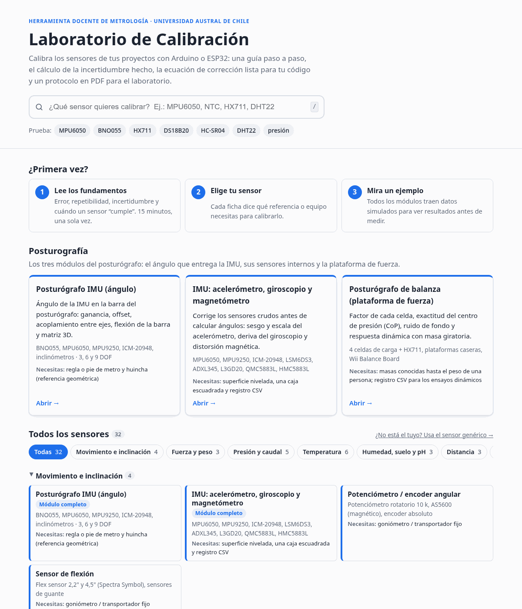
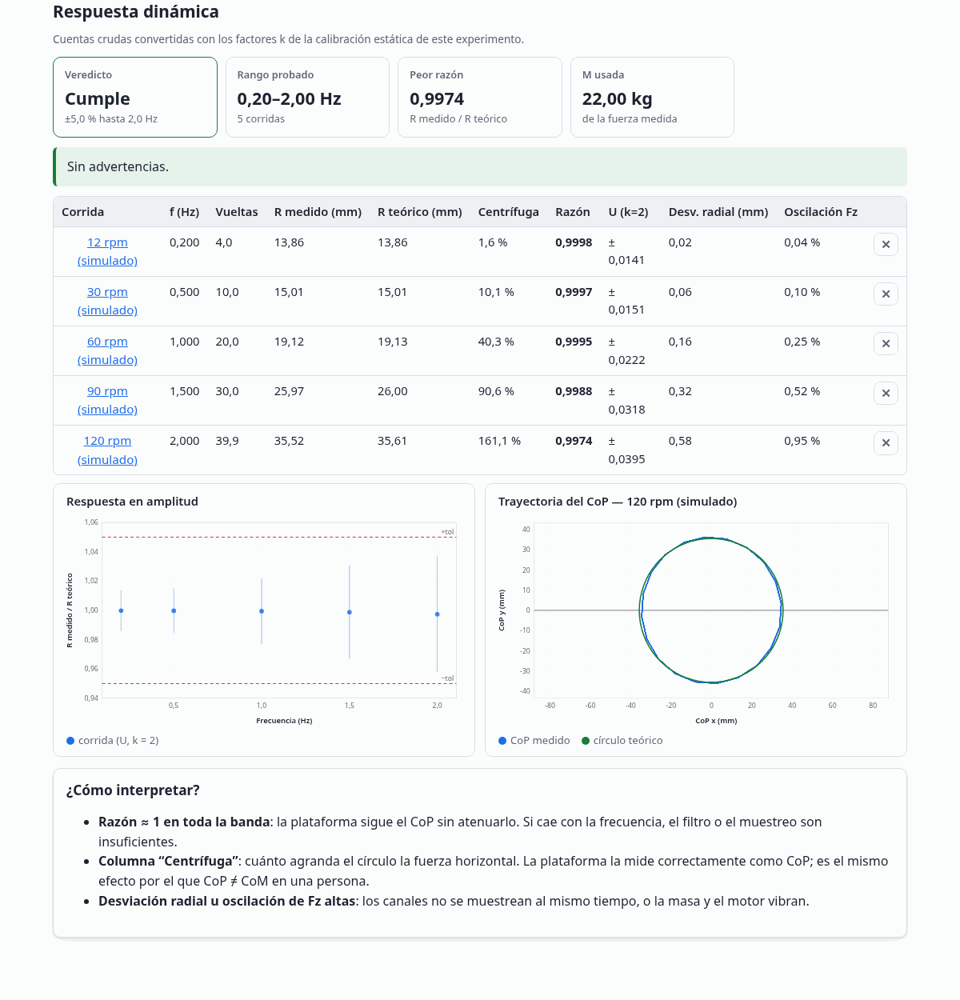
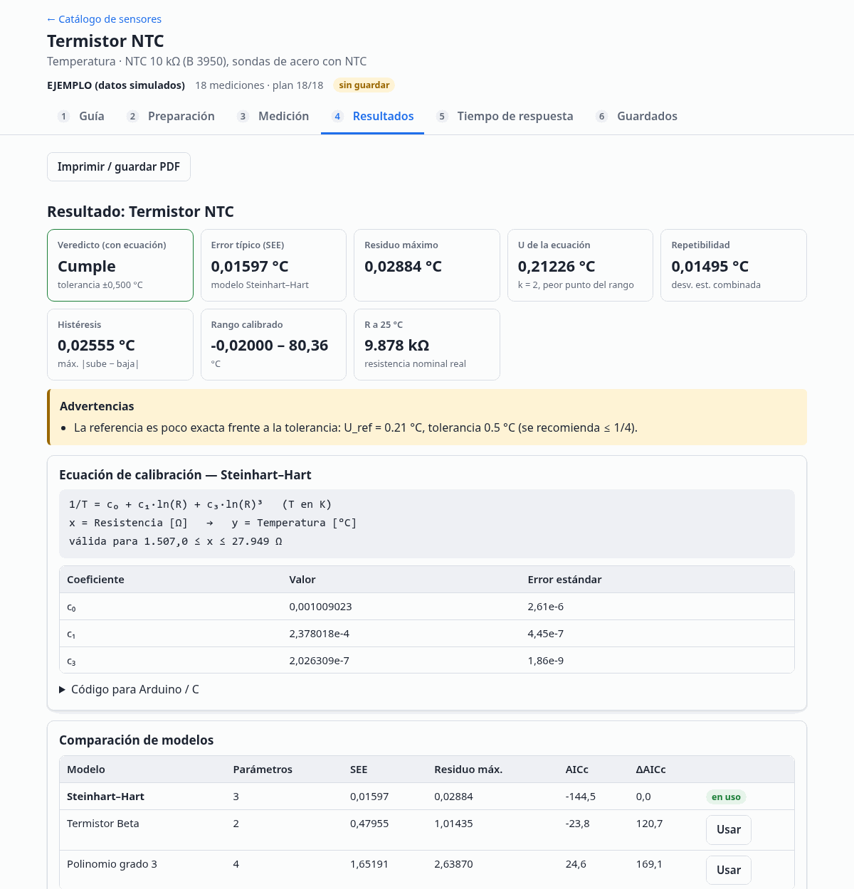
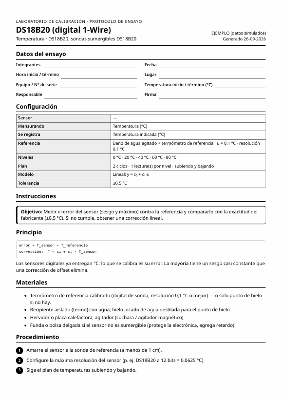

# Laboratorio de Calibración

[](LICENSE)


Guías y herramientas web para que estudiantes **calibren los sensores que se usan con placas de desarrollo** (Arduino, ESP32, Raspberry Pi Pico…):
posturógrafos con IMU y plataforma de fuerza, presión diferencial, caudal (Venturi, Pitot) y un **catálogo de 26 sensores**: temperatura,
humedad, distancia, fuerza, eléctricos, luz, ángulo, pH, suelo, caudal de líquidos y biomédicos.

Cada módulo:

1. **Explica** el principio físico, los materiales, el procedimiento y los errores comunes.
2. **Genera el plan de mediciones** y guía paso a paso: *“Ciclo 2 ↑: lleve el baño a ≈ 40 °C, espere el equilibrio y registre”*.
3. **Calcula** error, sesgo, repetibilidad, histéresis, no linealidad e **incertidumbre (GUM, k = 2)**, y decide si el sensor **cumple** una tolerancia.
4. **Entrega** la ecuación de corrección con su código C/Arduino, y un **protocolo de ensayo en PDF** con la hoja de registro para el laboratorio.

La página de inicio es un buscador: escriba el modelo del chip (*MPU6050*, *HX711*, *DS18B20*…) o la magnitud (*temperatura*, *distancia*).
Cada ficha dice qué referencia o equipo se necesita, y la sección *Continuar* retoma los experimentos en curso.

<p align="center"></p>

## Uso

No requiere instalación, servidor ni conexión a internet:

```bash
git clone https://github.com/Debaq/laboratorio-calibracion.git
# abrir laboratorio-calibracion/index.html con doble clic en el navegador
```

- Los datos se guardan en el navegador (`localStorage`). Para cambiar de computador o entregar un trabajo use **JSON**, **CSV** (separador `;`,
  coma decimal, listo para Excel en español) o **Respaldo completo** en la pestaña *Guardados*.
- Cualquier módulo se puede ver con datos simulados agregando `?ejemplo` a la dirección (p. ej. `imu.html?ejemplo`). Sirve para mostrarlo en clase.
- Se aceptan números con coma o punto decimal; las listas se separan con punto y coma (`0; 20; 40`).

## Módulos

### Posturografía

| Módulo | Qué calibra | Cómo |
|---|---|---|
| [**Posturógrafo IMU**](imu.html) | Ángulo de una IMU de 3, 6 o 9 DOF o de un inclinómetro montado en la barra | Referencia geométrica θ = asin(d/L) (≈ 50× mejor que un transportador), cero por ciclo, ganancia y offset, acoplamiento entre ejes, histéresis, flexión de la barra (voladizo), matriz de corrección 3×3 |
| [**IMU: sensores crudos**](imu-crudo.html) | Acelerómetro, giroscopio y magnetómetro | Acelerómetro por 6 posiciones (escala, sesgo, desalineación); giroscopio en reposo (sesgo, desviación de Allan: ARW e inestabilidad) y giro de ángulo conocido (escala); magnetómetro por ajuste de elipsoide (hierro duro y blando) |
| [**Posturógrafo de balanza**](balanza.html) | Plataforma de 4 celdas de carga + HX711 | **Estático**: factor de cada celda por equilibrio de fuerzas y momentos, CoP, linealidad, histéresis, fluencia. **Ruido de fondo**: métricas de estabilometría de una carga inmóvil (piso del instrumento). **Dinámico**: fantoma de masa giratoria, respuesta en amplitud de 0,1 a 2 Hz |

<p align="center"></p>

### Presión y caudal

| Módulo | Qué calibra | Cómo |
|---|---|---|
| [**Sensor de presión**](presion.html) | Sensor ΔP (MPX5010DP, MPXV7002…) | Manómetro en U: ΔP = (ρ_agua(T) − ρ_aire)·g(φ,h)·Δh; ecuación V → ΔP con prueba F e incertidumbre de predicción |
| [**Medidor Venturi**](venturi.html) | Coeficiente de descarga | Q = C_d·A₂·√(2ΔP/(ρ(1−β⁴))), C_d vs Reynolds (regresión ponderada), Mach |
| [**Tubo de Pitot**](pitot.html) | Coeficiente del Pitot | v = C·√(2ΔP/ρ), factor de perfil de velocidad |

### Catálogo de sensores

Un **motor genérico** más un **perfil por sensor** (`sensor.html?p=<id>`). Cada perfil define la referencia recomendada, el plan, el modelo de curva y la guía.

| Familia | Sensores | Referencia / particularidad |
|---|---|---|
| Movimiento e inclinación | Potenciómetro/encoder, sensor de flexión (+ los módulos de IMU) | Goniómetro |
| Fuerza y peso | Celda de carga + HX711, FSR (+ la plataforma del posturógrafo) | Masas conocidas; ley de potencia; histéresis y fluencia |
| Presión y caudal | Barómetro BMP280/BME280, caudalímetro de turbina YF-S201 (+ módulos de presión, Venturi y Pitot) | Presión de estación desde QNH; factor K y su dependencia del caudal |
| Temperatura | NTC, LM35/TMP36, DS18B20, termocupla K (MAX31855/6675), PT100/PT1000 (MAX31865), DHT22/SHT31/BME280 | Punto de hielo, ebullición corregida por presión, baño con termómetro patrón; Steinhart–Hart; α de la PT100; constante de tiempo τ |
| Humedad, suelo y pH | DHT22, SHT31, BME280, AHT20; humedad de suelo capacitiva; electrodo de pH | Sales saturadas (Greenspan, 1977); método gravimétrico; buffers 4/7/10 y eficiencia de Nernst |
| Distancia | HC-SR04, VL53L0X/L1X, Sharp GP2Y0A21 | Corrección de la velocidad del sonido por temperatura; modelo inverso |
| Luz | LDR, BH1750/TSL2561/VEML7700 | Luxómetro; ley de potencia |
| Electricidad | ADC de la placa (UNO, ESP32), ACS712, INA219/INA226 | Multímetro de referencia; no linealidad del ADC del ESP32 |
| Biomédicos | SpO₂ y frecuencia cardiaca (MAX30102) | Comparación con equipo comercial: Bland–Altman, ARMS |
| Otros | **Sensor genérico** | Magnitud y unidades libres, para cualquier sensor que no esté en la lista |

El motor ofrece:

- **Modelos** lineal, proporcional, polinomios de grado 2 y 3, logarítmico, potencia, inverso, Beta y Steinhart–Hart, ajustados por mínimos cuadrados y **comparados por AICc**.
- **Modo calibración**: repetibilidad, histéresis, incertidumbre de predicción, error sin corregir, conformidad y rango válido de la ecuación.
- **Modo comparación** (Bland–Altman): sesgo con su IC, límites de acuerdo del 95 %, sesgo proporcional, ARMS y conformidad tras corregir el offset.
- **Tiempo de respuesta** τ y t₉₀ a partir de un escalón (CSV), calculado sobre el valor calibrado.

<p align="center"></p>

### Protocolo de ensayo en PDF

Todos los módulos tienen **Descargar protocolo (PDF)**: datos del grupo, configuración, instrucciones completas y **hoja de registro** con cada acción del plan
y columnas en blanco para anotar a mano. Se genera con el diálogo de impresión del navegador (*Guardar como PDF*), así que funciona sin internet.

<p align="center"></p>

## Fundamentos

La página [Fundamentos de calibración](fundamentos.html) resume los conceptos que usan todos los módulos (VIM y GUM):

```
Modelo de error:          lectura = a + b · valor_verdadero + ε
Incertidumbre tipo B:     resolución δ → u = δ/√12      tolerancia ±a → u = a/√3
Propagación:              u_c(y)² = Σ (∂f/∂xᵢ)² · u(xᵢ)²
Expandida:                U = k · u_c   (k = 2, ≈ 95 %)
Conformidad:              |error máximo| + U_referencia ≤ tolerancia
Referencia adecuada:      TUR = tolerancia / U_referencia ≥ 4
```

## Estructura

```
index.html  fundamentos.html  imu.html  imu-crudo.html  balanza.html
presion.html  venturi.html  pitot.html  sensor.html (catálogo: ?p=<id>)
css/lab.css                      estilos (claro/oscuro, impresión, protocolo PDF)
js/core/
  linalg.js                      mínimos cuadrados QR, inversa, autovalores (Jacobi)
  stats.js                       descriptiva (n−1), t y F, polyfit con covarianza, prueba F
  physics.js                     g local, ρ del agua (Tanaka 2001), aire, vigas, ebullición, sales, Nernst
  uncertainty.js                 incertidumbre tipo A/B, combinada, expandida
  signal.js                      filtro de fase cero, círculo, elipsoide, Allan, escalón, estabilometría
  csv.js                         lectura tolerante de CSV (monitor serie, Excel)
  store.js  ui.js  app.js        almacenamiento, gráficos SVG, estructura común de los módulos
js/modules/                      *-model.js (matemática pura, testeable) y *-ui.js (interfaz)
js/perfiles/                     registro y perfiles de sensores del catálogo
tests/                           pruebas con node:test
docs/img/                        capturas
```

Principios de diseño:

- **Sin dependencias ni compilación**: HTML, CSS y JavaScript con scripts clásicos (no módulos ES), para que funcione abriendo el archivo (`file://`).
- **Solo se guardan datos crudos** (configuración + mediciones); los resultados se recalculan siempre, así que cambiar un parámetro reprocesa todo.
- **La matemática está separada de la interfaz**: cada `*-model.js` se prueba en Node con datos simulados de parámetros conocidos.

## Agregar un sensor

Agregue un perfil en `js/perfiles/` (y su `<script>` en `sensor.html` e `index.html`). Ejemplo mínimo:

```js
R.register({
    id: 'mi-sensor', family: 'otros', name: 'Mi sensor', examples: 'XYZ-123',
    quantity: 'Nivel', unit: 'cm', symbol: 'h',
    reading: { label: 'Cuentas del ADC', unit: 'cuentas' },
    references: [{ id: 'regla', label: 'Regla graduada', u: 0.05 }], refRes: 0.1,
    levels: [0, 10, 20, 30, 40], cycles: 2, bidirectional: true,
    models: ['lineal', 'poly2'], defaultModel: 'lineal', tolerance: 0.5,
    guide: { objetivo: '…', principio: '…', materiales: ['…'], procedimiento: ['…'], checklist: ['…'], errores: ['…'] },
    example: { forward: (h, cfg, row, g) => 120 + 21.5 * h + g(2), levelToRef: lv => lv }
});
```

El motor se encarga del plan guiado, el análisis, los gráficos, el protocolo PDF y el guardado.

## Pruebas

```bash
npm test          # o: node --test tests/*.test.js   (Node 18+)
```

Las pruebas verifican el núcleo matemático contra valores de tabla (t de Student, F, densidad del agua, gravedad, Anscombe) y que cada modelo
**recupere los parámetros de datos simulados**: coeficientes Steinhart–Hart, factores de celdas, matriz del acelerómetro, centro del magnetómetro,
τ de un escalón, ARW del giroscopio, respuesta de la masa giratoria, entre otros.

## Advertencias

- Es una herramienta **docente**. Los valores de tablas (sales saturadas, buffers de pH, especificaciones de sensores) y los criterios de norma citados
  (ISO 80601-2-61, ANSI/AAMI EC13, IEC 60751) deben contrastarse con las fuentes originales antes de un uso formal.
- Los sensores biomédicos caseros **no deben usarse para decisiones clínicas**. Las pruebas con personas requieren voluntarios sanos y consentimiento.
- Las tolerancias por defecto son valores de partida: defínalas según el uso previsto.

## Autoría

Autor: **Nicolás Baier Quezada** · Universidad Austral de Chile.
Con la colaboración de Vanessa Uribe en la versión inicial.

## Licencia

[MIT](LICENSE) © 2026 Nicolás Baier Quezada
